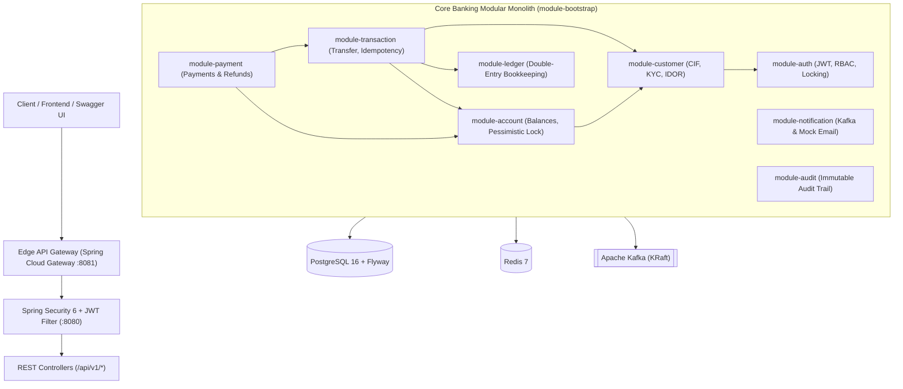
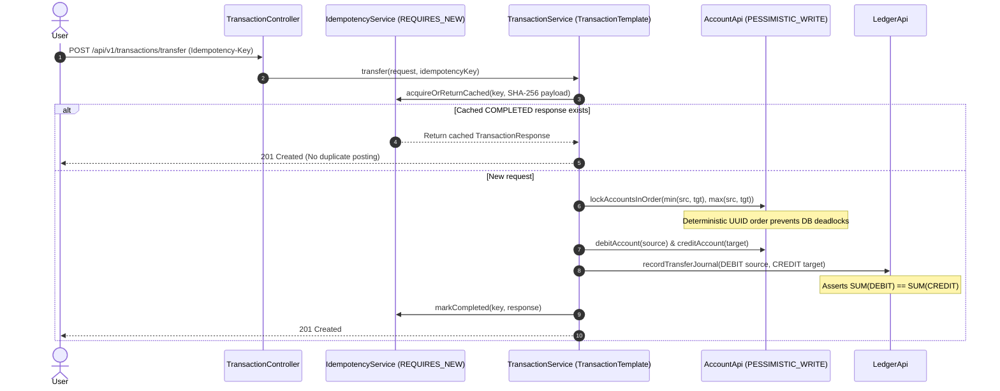

# Core Banking System

> A high-reliability Core Banking System simulation built with **Java 21**, **Spring Boot 3**, **PostgreSQL 16**, **Redis 7**, and **Apache Kafka**, following **Modular Monolith** and **Domain-Driven Design (DDD)** principles.

---

## 🏛️ Architecture Overview

The backend is engineered as a **Modular Monolith** to guarantee **ACID transaction guarantees** and **Double-Entry Bookkeeping (Sổ cái kế toán kép)** on a single PostgreSQL engine while strictly decoupling modules via public `*Api` interfaces and DTOs (`exposed/`):



### Project Structure

```text
BankingCore/
├── .github/workflows/ci.yml      # GitHub Actions CI (JDK 21 + Gradle test for backend & gateway)
├── gateway/                      # Edge Microservice (Spring Cloud Gateway :8081 -> :8080, CORS, X-Correlation-Id)
├── backend/
│   ├── module-common/            # BaseAuditEntity, ErrorCodes, ApiResponse, Financial Constants
│   ├── module-auth/              # Spring Security 6, JWT, Refresh Token Rotation, Account Locking, RBAC
│   ├── module-customer/          # Customer lifecycle (CIF) & IDOR protection
│   ├── module-account/           # SAVINGS/CURRENT/SYSTEM accounts, BigDecimal(19,4), Locking
│   ├── module-transaction/       # Deposit, Withdrawal, Transfer, Reversal, Idempotency-Key
│   ├── module-ledger/            # Immutable Double-Entry Journals & Entries (DEBIT = CREDIT)
│   ├── module-payment/           # Merchant/Bill Payments & Refunds
│   ├── module-notification/      # Kafka Event Consumer & Mock Email Notifications
│   ├── module-audit/             # Immutable Security & Activity Audit Logs (Secret Masking)
│   └── module-bootstrap/         # Main App, Flyway (V1-V4), OpenAPI, Reconciliation, Concurrency Tests
├── frontend/                     # (Planned frontend web app)
├── docker-compose.yml            # PostgreSQL 16, Redis 7, Kafka (KRaft mode)
└── README.md
```

---

## 🔄 Fund Transfer & Concurrency Flow



---

## 🛠️ Technology Stack

- **Language:** Java 21 LTS
- **Framework:** Spring Boot 3.3.5 (MVC, Data JPA, Validation, Security 6, Actuator)
- **Security:** Stateless JWT (JJWT 0.12.6), Refresh Token Rotation (SHA-256), BCrypt, RBAC (`ADMIN`, `STAFF`, `CUSTOMER`), IDOR Protection
- **Database:** PostgreSQL 16, Flyway Migrations (`V1`–`V4`), Hibernate `ddl-auto: validate`
- **Caching & Messaging:** Redis 7, Apache Kafka (KRaft mode)
- **Testing:** JUnit 5, Mockito, Spring Boot Test, MockMvc, Testcontainers (PostgreSQL 16), H2 (PostgreSQL mode)
- **Build & CI:** Gradle 8.10.2 (Multi-module), Docker Compose, GitHub Actions

---

## 🚀 Getting Started

### 1. Prerequisites
- Java 21+
- Docker & Docker Compose (for PostgreSQL, Redis, Kafka, and Testcontainers)

### 2. Environment Configuration
```bash
cd backend
cp .env.example .env
# Update DB_PASSWORD, JWT_SECRET, etc. in .env if needed
```

### 3. Start Infrastructure Services
```bash
docker compose up -d
```
This starts:
- **PostgreSQL 16** on port `5432` (`core_banking`)
- **Redis 7** on port `6379`
- **Apache Kafka** on port `9092`

### 4. Build & Run All Tests
```bash
cd backend
./gradlew test
```

### 5. Run the Application
```bash
cd backend
./gradlew :module-bootstrap:bootRun
```

### 6. API Documentation & Health
- **Swagger UI:** `http://localhost:8080/swagger-ui.html`
- **OpenAPI JSON:** `http://localhost:8080/v3/api-docs`
- **Health Check:** `http://localhost:8080/api/v1/health`
- **Reconciliation (ADMIN):** `GET /api/v1/reconciliation/accounts/{accountId}`

---

## 📋 Implementation Progress

- [x] **Phase 1:** Requirements Analysis & Business Rules Specification
- [x] **Phase 2:** System Architecture, ERD & Sequence Design
- [x] **Phase 3:** Gradle Multi-Module, Docker Compose, Flyway, Baseline Setup
- [x] **Phase 4 - Auth:** Authentication, JWT, Refresh Token Rotation, Account Locking & RBAC ([README](backend/module-auth/README.md))
- [x] **Phase 4 - Customer:** Customer Management (CIF) & IDOR Protection ([README](backend/module-customer/README.md))
- [x] **Phase 4 - Account:** Account Lifecycle, BigDecimal(19,4), Optimistic & Pessimistic Locking ([README](backend/module-account/README.md))
- [x] **Phase 4 - Ledger:** Immutable Double-Entry Bookkeeping Engine & Reversals ([README](backend/module-ledger/README.md))
- [x] **Phase 4 - Transaction:** Deposit, Withdrawal, Transfer, Reversal, Deadlock Prevention & Idempotency ([README](backend/module-transaction/README.md))
- [x] **Phase 4 - Payment:** Merchant/Bill Payments & Refunds ([README](backend/module-payment/README.md))
- [x] **Phase 4 - Notification:** Kafka Event Consumer & Mock Email Notifications ([README](backend/module-notification/README.md))
- [x] **Phase 4 - Audit:** Immutable Audit Logs with Secret Masking ([README](backend/module-audit/README.md))
- [x] **Phase 5 & 7:** Concurrency Integration Tests (20-thread transfers, withdrawals, deadlock prevention, idempotency), Reconciliation API, OpenAPI JWT config, Testcontainers (PostgreSQL 16), and GitHub Actions CI
